# ScoreKnight
ScoreKnight is a modern, native Android sports application providing live scores, match updates, and team statistics. Built to deliver a seamless and unified experience, the app supports full tracking for both **Cricket** and **Football**, powered by a robust Spring Boot backend that aggregates data from external sports APIs.
## Project Overview
*   **What ScoreKnight is**: A dual-sport companion app offering live, upcoming, and completed match data in a clean, intuitive interface.
*   **What problem it solves**: It aggregates complex and disparate sports APIs (API-Football, CricAPI) into a unified, consistent user experience via a single custom backend, reducing client-side complexity and bandwidth.
*   **Main user experience**: Users can smoothly navigate between Cricket and Football modules, view match details, inspect standings, and authenticate to save their favorite matches across devices without being forced to log in initially.
*   **Sports supported**: Cricket, Football.
*   **Main technical approach**: A modern Android frontend utilizing Jetpack Compose, Coroutines, and Hilt, driven by a Java 21 Spring Boot backend exposing unified REST endpoints.
## Features
### Cricket
*   **Cricket Home**: Curated dashboard with auto-scrolling player banners.
*   **Live Matches**: Real-time score updates for ongoing games.
*   **Upcoming Matches**: Schedules for future fixtures.
*   **Recent Results**: Completed match data.
*   **Match Details**: Comprehensive breakdown including Match Info, Live status, and Squad listings.
### Football
*   **Football Home**: Customized dashboard mirroring the cricket experience.
*   **Live Matches**: Real-time scores and elapsed match time.
*   **Upcoming Matches**: Scheduled future fixtures.
*   **Recent Results**: Completed match history (supporting standard time, extra time, and penalties).
*   **Match Details**: Match Info and specific match Events (goals, cards, substitutions).
*   **Standings**: Current league tables and team rankings.
### Authentication
*   **Google Sign-In**: Integrated one-tap authentication via Firebase and Google Credential Manager.
*   **Email/Password**: Native signup and login flows with client-side validation.
*   **Profile Management**: Account overview and secure logout functionality.
*   **Optional Login**: Users can browse all sports data as guests, only needing to log in for personalized features.
### Favorites
*   **Cross-Device Syncing**: When authenticated, users can favorite specific matches. These favorites are securely synced to the Spring Boot backend and retrieved automatically upon login, persisting state locally and remotely across app sessions

## Screenshots

### Landing

| Cricket Landing | Football Landing |
|---|---|
| 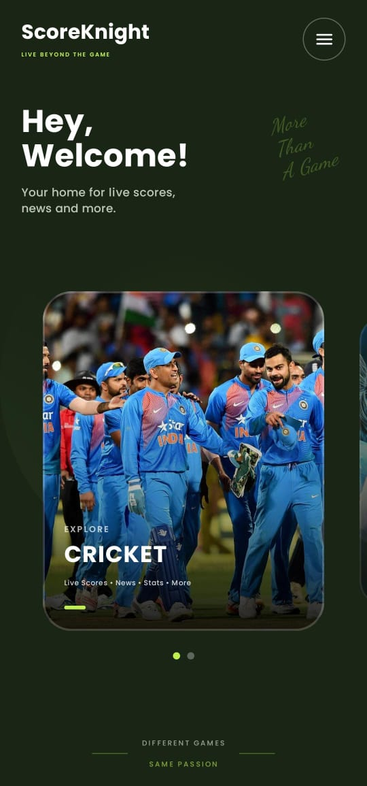 | 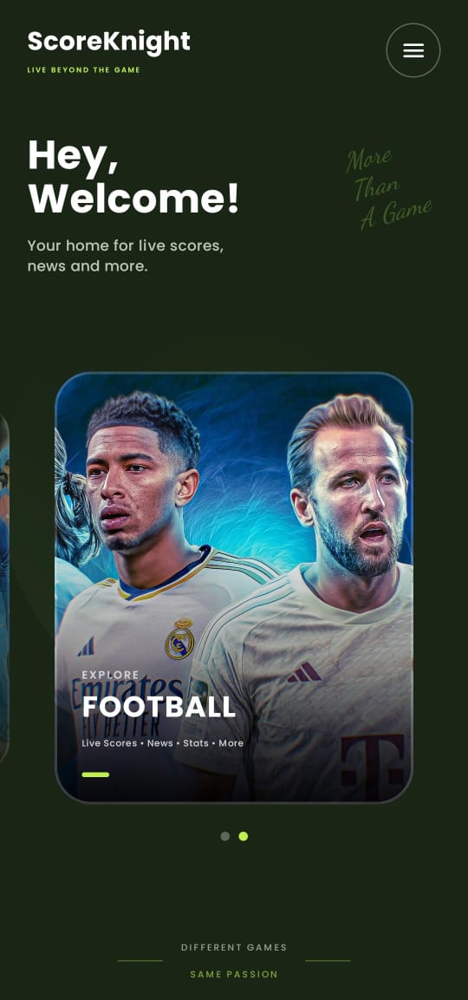 |

### Cricket

| Home | Matches |
|---|---|
| 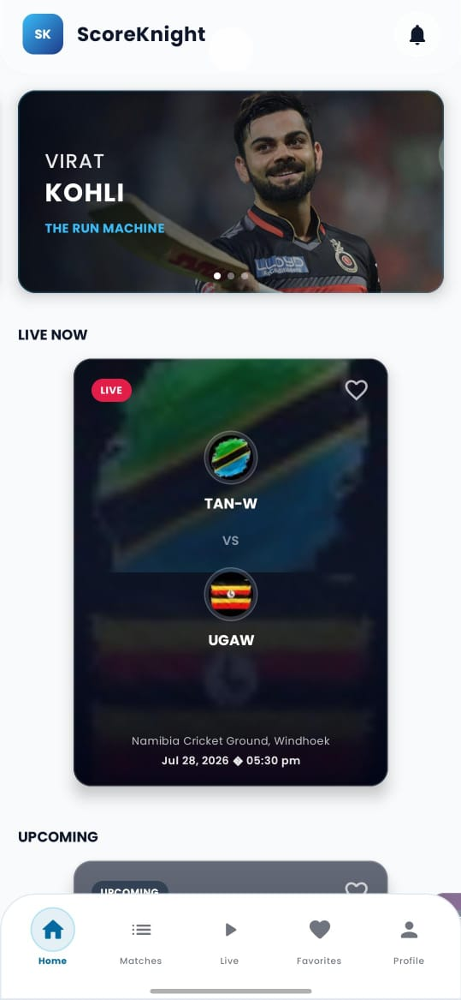 | 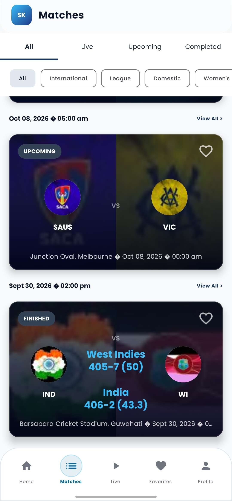 |

| Match Details | Home - Alternative View |
|---|---|
| 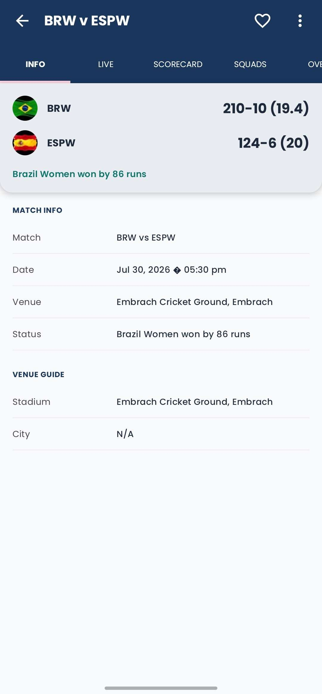 | 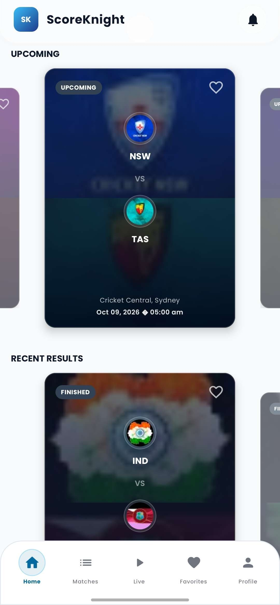 |

### Football

| Home | Matches |
|---|---|
| 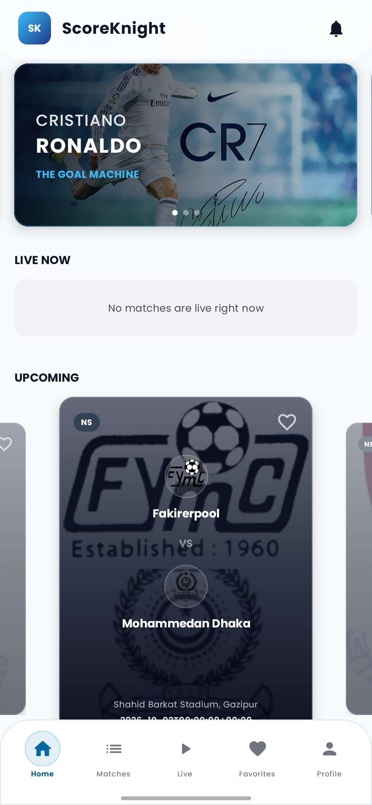 | 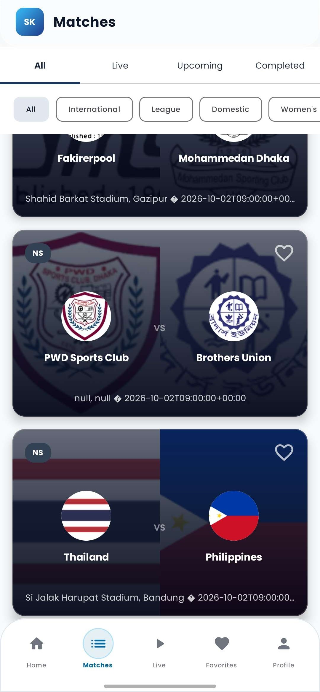 |

| Match Details | Matches - Alternative View |
|---|---|
| 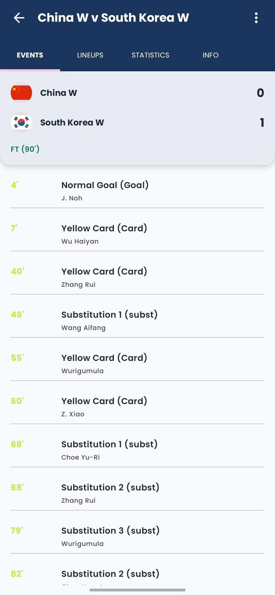 | 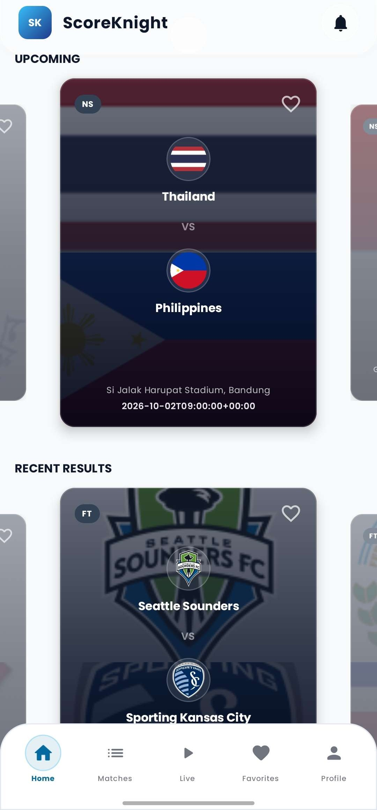 |

### Authentication & Profile

| Login | Sign Up |
|---|---|
| 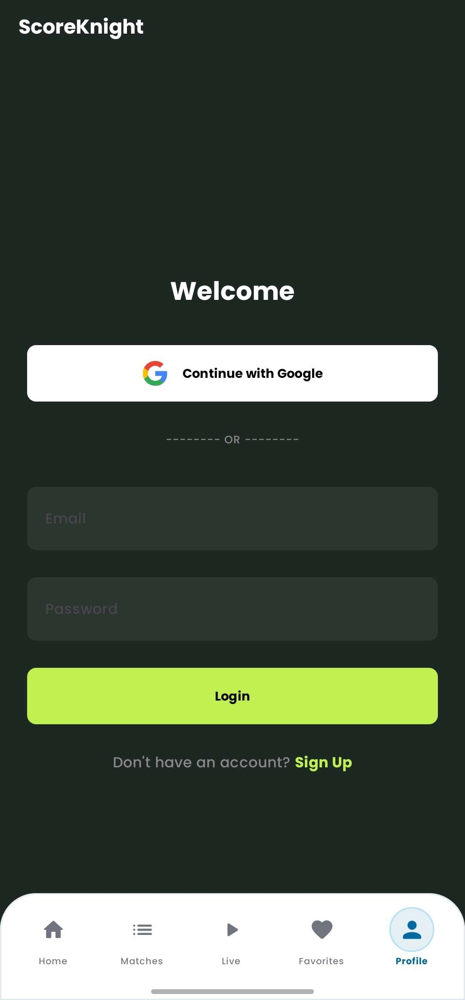 | 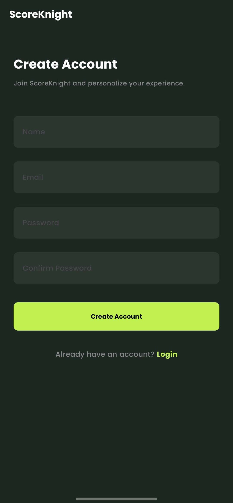 |

| Profile | Favorites |
|---|---|
| 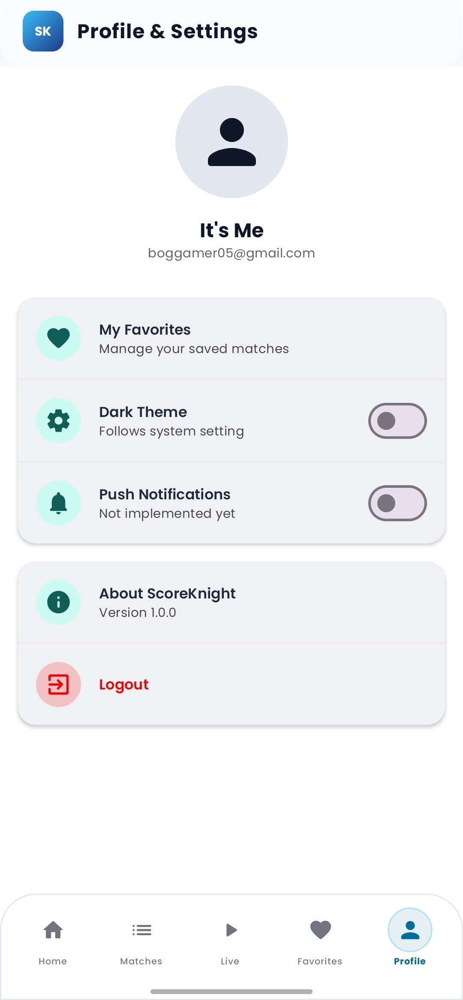 | 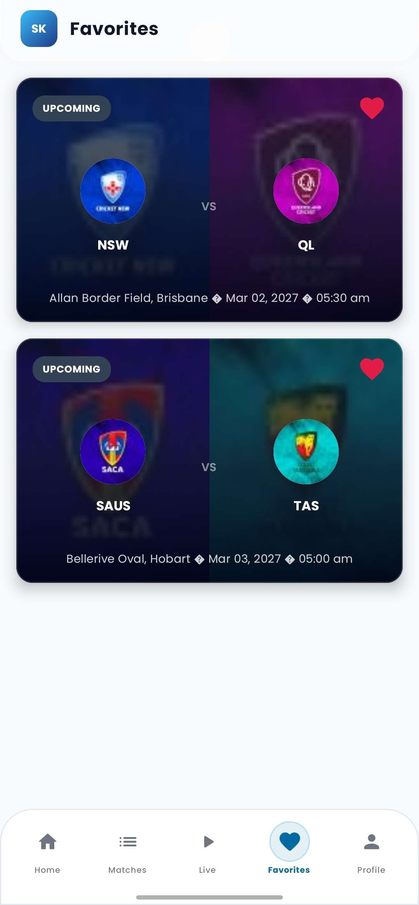 |
  
## Technology Stack
### Android Frontend
| Technology | Version | Purpose |
|---|---|---|
| **Kotlin** | 1.9.23 | Primary programming language |
| **Android Gradle Plugin** | 8.5.1 | Build system |
| **Android SDK** | Min 26, Target 34 | Platform API targeting |
| **Jetpack Compose (BOM)**| 2024.06.00 | Modern declarative UI toolkit |
| **Navigation Compose** | 2.7.7 | Type-safe declarative routing |
| **Retrofit** | 2.11.0 | Type-safe HTTP client |
| **OkHttp** | 4.12.0 | Networking and logging interceptor |
| **Kotlinx Serialization** | 1.6.3 | JSON parsing and DTO mapping |
| **Hilt (Dagger)** | 2.51.1 | Dependency Injection |
| **KSP** | 1.9.23-1.0.20 | Symbol processing for Hilt |
| **Coil** | 2.6.0 | Image loading and caching |
| **Google ID Services** | 1.1.0 / 1.2.2 | Google Sign-In and Credential Manager |
### Backend Service
| Technology | Version | Purpose |
|---|---|---|
| **Java** | 21 | Primary programming language |
| **Spring Boot** | 4.1.0 | Application framework and REST server |
| **JJWT** | 0.12.5 | JSON Web Token generation and validation |
| **Google API Client**| 2.4.0 | OAuth token verification |

## Architecture
ScoreKnight strictly adheres to **Clean Architecture** principles and the **MVVM** pattern, ensuring separation of concerns and testability.
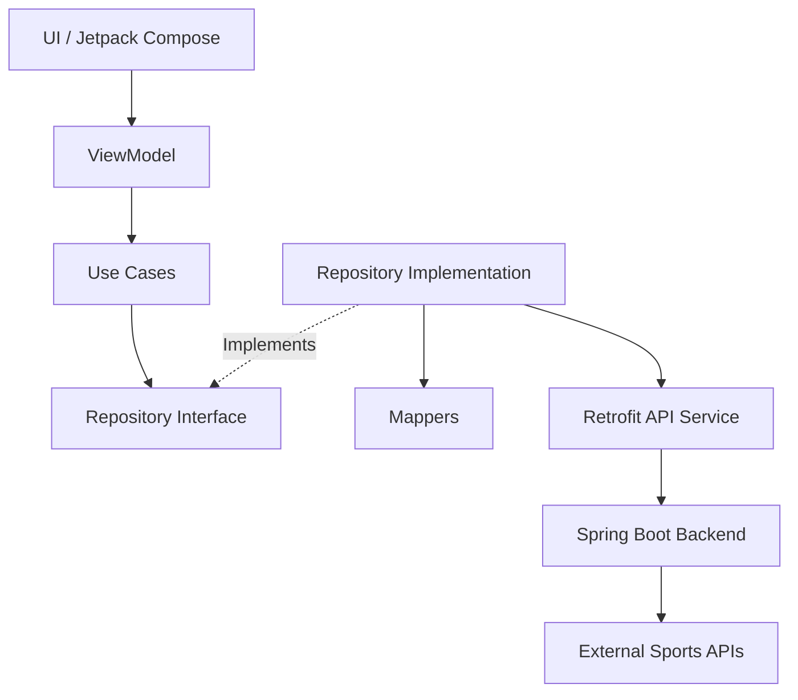
### Layer Responsibilities
*   **Presentation (`presentation`, `ui`, `football/presentation`)**: Contains all Jetpack Compose screens, reusable UI components, and ViewModels. ViewModels manage and emit immutable `UiState` representing Loading, Success, Error, or Empty states.
*   **Domain (`domain`, `football/domain`)**: The core business logic layer. Contains pure Kotlin Domain Models, Use Cases encapsulating specific actions, and Repository Interfaces defining data contracts independent of origin.
*   **Data (`data`, `football/data`)**: Responsible for data retrieval and formatting. Contains Repository Implementations, DTOs (Data Transfer Objects representing network JSON), Mappers (converting DTOs to safe Domain models), and local cache managers (e.g., `FavoritesManager`).
*   **Remote (`data/remote/api`)**: Retrofit interfaces mapping directly to the ScoreKnight backend REST API.
*   **Backend (`scoreknight` Spring Boot)**: Aggregates, filters, and normalizes data from complex external sports APIs before sending clean payloads to the Android client. Manages JWT authentication and persistent favorite storage.
